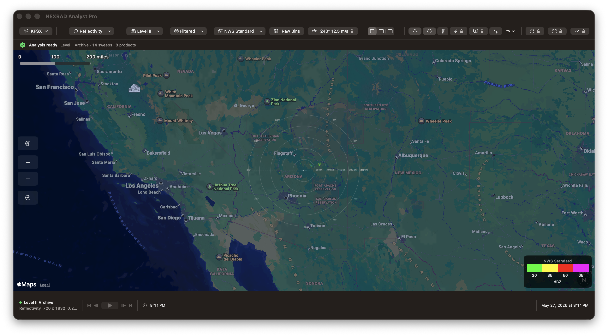

# NEXRAD Analyst Pro

Public App Store support site for NEXRAD Analyst Pro, a professional NEXRAD Level II weather radar analysis application for Mac, iPhone, and Apple Watch.

This repository intentionally contains only public marketing, support, privacy-policy, and App Store-facing documentation. It does not contain app source code, internal planning documents, release artifacts, signing material, secrets, license-generation tools, or private App Store Connect configuration.

## Pages

- **Marketing:** `index.html` - Product overview, target audiences, features, and pricing
- **Support:** `support.html` - Help, instructions, troubleshooting, and support contact
- **Privacy Policy:** `privacy.html` - Privacy policy for App Store review and customers

## Public URLs

- Website: https://noktirnal42.github.io/NEXRADAnalyst/
- Support: https://noktirnal42.github.io/NEXRADAnalyst/support.html
- Privacy: https://noktirnal42.github.io/NEXRADAnalyst/privacy.html

## Support

- **Email:** FreeRangeLabs@drumnbus.com
- **Public issue tracker:** [Open a GitHub Issue](https://github.com/noktirnal42/NEXRADAnalyst/issues/new?template=support_request.md)

## About

NEXRAD Analyst Pro is developed by Free Range Labs. It is not affiliated with the National Weather Service, NOAA, or Apple Inc.

## See the app

[Explore the website](https://noktirnal42.github.io/NEXRADAnalyst/) · [View on the App Store](https://apps.apple.com/app/id6772084538)

Website imagery uses actual app captures. The Mac screenshot shows an archived radar scan. The iPad screenshot shows analysis controls with a schematic map preview.
